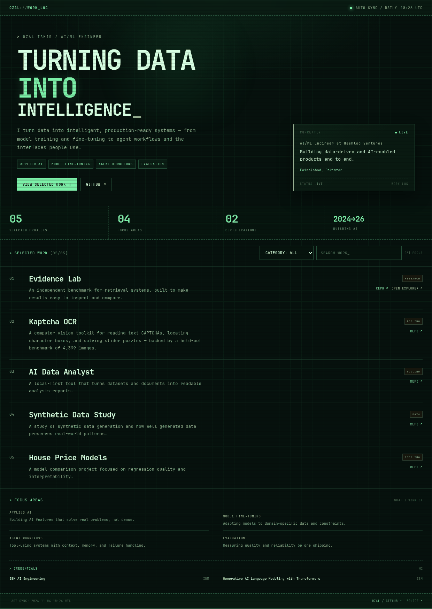

<h1>Ozal Tahir</h1>

<strong>AI/ML Engineer</strong> · Turning data into intelligence

I build data-driven and AI-enabled products end to end — from model training and fine-tuning to agent workflows, automation, and the interfaces people use.

  <a href="https://github.com/ozalt">GitHub</a> &nbsp;·&nbsp;
  <a href="https://ozalt.github.io/ozalt/">Work log</a> &nbsp;·&nbsp;
  <a href="https://ozalt.github.io/ozalt/lab/">Evidence Lab</a>

---

## `$ whoami`

I'm an AI/ML engineer at **Hashlog Ventures**, where I build data-driven and AI-enabled products end to end — from backend systems and APIs to intelligent agents, automation workflows, and data pipelines.

My work combines AI engineering, data science, and applied AI. I care about turning complex data and AI challenges into production-ready applications: systems that are useful, measurable, and built to last.

Based in Faisalabad, Pakistan.

## `$ cat focus.txt`

- **Applied AI** — building AI features that solve real problems, not demos.
- **Model fine-tuning** — adapting models to domain-specific data and constraints.
- **Agent workflows** — tool-using systems with context, memory, and failure handling.
- **Evaluation** — measuring quality and reliability before shipping.

## `$ ./monitor`

  

  <a href="https://ozalt.github.io/ozalt/"><strong>Open the live work log →</strong></a> 
  Selected work · focus areas · credentials

## `$ ls work/`

### 01 · [Evidence Lab](https://github.com/ozalt/evidence-lab)

**An independent benchmark for retrieval systems, built to make results easy to inspect and compare.**

→ [Read the results](https://github.com/ozalt/evidence-lab) · [Open the explorer](https://ozalt.github.io/ozalt/lab/)

### 02 · [Event Advisor](https://github.com/ozalt/EVENT-ADVISOR-REACT-PROJECT)

A full-stack marketplace for venues and vendors — listings, accounts, and discovery.

### 03 · [AI Data Analyst](https://github.com/ozalt/AI-Data-Analyst-Reporter)

A local-first tool that turns datasets and documents into readable analysis reports.

<strong>More work</strong>

 

### 04 · [Synthetic Data Study](https://github.com/ozalt/data-generation-using-ctgan)

A study of synthetic data generation and how well generated data preserves real-world patterns.

### 05 · [House Price Models](https://github.com/ozalt/Machine-Learning-Models-Comparison-For-House-Prices)

A model comparison project focused on regression quality and interpretability.

## `$ cat credentials.txt`

- IBM AI Engineering — IBM
- Generative AI Language Modeling with Transformers — IBM

---

  Work log refreshed daily by GitHub Actions · <a href="https://github.com/ozalt/ozalt">source</a>

